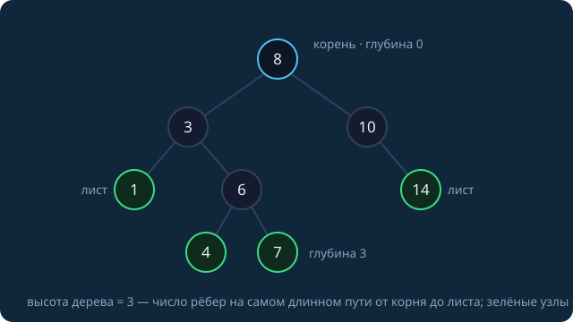
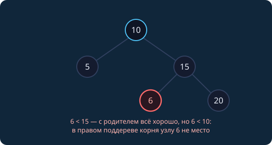

Первый семинар второго семестра. Весь первый семестр данные лежали «лентой» — массив, вектор, куча в массиве; сегодня они впервые складываются в **иерархию**. Цель — динамическое множество с порядком: вставка, поиск, минимум, «следующий по величине» и диапазонные запросы за $O(\log n)$ — ровно то, что умел `std::set` из занятия 17, которым мы пользовались как чёрным ящиком. За два занятия построим его содержимое сами. Замеры реальные (Apple M-серия, `clang++ -O2`).

## Чего не хватало структурам первого семестра

| структура | поиск | вставка | минимум | обход по порядку |
|---|---|---|---|---|
| отсортированный vector (зан. 12) | $O(\log n)$ | $\Theta(n)$ — сдвиг хвоста | $O(1)$ | даром |
| двоичная куча (зан. 25) | $\Theta(n)$ | $O(\log n)$ | $O(1)$ | нет |
| unordered_set (зан. 17) | $O(1)$ в среднем | $O(1)$ в среднем | $\Theta(n)$ | нет порядка |
| **std::set (зан. 17)** | $O(\log n)$ | $O(\log n)$ | $O(1)$ | **есть** |

## Бинарные деревья: словарь

> [!def] Бинарное дерево
> Либо пустое, либо тройка (корень, $L$, $R$), где $L$ и $R$ — бинарные деревья. Дети различимы: левый и правый.



**Глубина узла** — число рёбер от корня до него; **высота дерева** — максимальная глубина (меряем в рёбрах, как в [весеннем конспекте]({})); **лист** — узел без детей; **уровень $i$** — все узлы глубины $i$. Определение рекурсивно, поэтому почти всё о деревьях пишется тремя строками: обработай корень, рекурсия влево, рекурсия вправо.

Свойства (оба — индукция и геометрическая сумма из занятия 6):

- на уровне $i$ — не более $2^i$ узлов; в дереве высоты $h$ — не более $2^{h+1}-1$ узлов;
- перевёрнутая форма: у дерева с $n$ узлами $h \ge \lceil \log_2(n+1) \rceil - 1$. Для $10^6$ узлов $h \ge 19$ — ниже логарифма не прыгнуть.

Знакомый частный случай — **почти полное** дерево: это форма двоичной кучи из занятия 25, поэтому куча жила в массиве без указателей. Сегодняшние деревья — произвольной формы, и вся драма занятия в том, что каждая операция стоит $O(h)$: от «шара» до «палки».

### Узел в памяти

```cpp
struct Node {
    int   key;      // 4 байта
    Node* left;     // 8
    Node* right;    // 8
};
static_assert(sizeof(Node) == 24);  // 4 + 4 набивки + 8 + 8 (укладка — зан. 18)

Node* root = nullptr;               // пустое дерево — это nullptr
```

Дерево — «список с двумя хвостами»: узлы разбросаны по куче и связаны указателями. Массивное представление кучи ($2i+1$, $2i+2$) здесь не годится: произвольное дерево высоты $h$ потребовало бы до $2^{h+1}-1$ ячеек — дырки съедят память. Полезных данных в узле 4 байта из 24 — дерево платит памятью за гибкость; плюс прыжки по куче — это кэш-промахи (зан. 17), увидим их в замере поиска. В конспекте и на семинаре — сырые указатели, чтобы видеть механику; владение и `unique_ptr` (зан. 14) обсудим на практикуме.

## Обходы

Три DFS-обхода — одна и та же рекурсия, различается только позиция «печати»:

```cpp
void preorder(Node* t)  { if (!t) return; printf("%d ", t->key); preorder(t->left);  preorder(t->right); }
void inorder(Node* t)   { if (!t) return; inorder(t->left);  printf("%d ", t->key);  inorder(t->right);  }
void postorder(Node* t) { if (!t) return; postorder(t->left); postorder(t->right); printf("%d ", t->key); }
```

Для дерева с картинки: pre `8 3 1 6 4 7 10 14` · in `1 3 4 6 7 8 10 14` · post `1 4 7 6 3 14 10 8`. In-order выдал возрастание — это свойство дерева *поиска*, к нему вернёмся ниже.

Четвёртый обход — **в ширину** (level-order), очередью из занятия 8:

```cpp
void levelOrder(Node* root) {
    std::queue<Node*> q;
    if (root) q.push(root);
    while (!q.empty()) {
        Node* t = q.front(); q.pop();
        printf("%d ", t->key);
        if (t->left)  q.push(t->left);
        if (t->right) q.push(t->right);
    }
}
```

| обход | типичное применение |
|---|---|
| pre-order | скопировать/сериализовать дерево: корень раньше детей |
| in-order | ключи BST по возрастанию |
| post-order | безопасно удалить (сначала детей); вычислить дерево выражения |
| level-order | «по слоям»; предвестник графовых обходов (зан. 16) |

Память: DFS держит в стеке $O(h)$, BFS — $O(\text{ширины уровня})$, на почти полном дереве это до $n/2$ узлов.

### Глубина рекурсии = высота дерева

Каждый рекурсивный вызов — кадр на стеке (зан. 5). Для сбалансированного дерева это ≈ $\log_2 n$ кадров — безопасно. Для цепочки из $10^6$ узлов — $10^6$ кадров, и стек в 8 МБ лопается. Живой эксперимент:

```
# цепочка из 10^6 узлов, рекурсивный inorder
clang++ -O0:  ошибка сегментации (и правая, и левая цепочка)
clang++ -O2:  правая цепочка — обход выжил (?!), левая — ошибка сегментации
```

Разгадка: вызов `inorder(t->right)` стоит последним — он **хвостовой**, и оптимизатор превратил его в цикл (зан. 18: компилятор переписывает программу). Левый вызов хвостовым не является — его не спасёт ничто. Мораль: рекурсия по дереву легальна, пока вы отвечаете за высоту; итеративный in-order со своим стеком — задача практикума.

## Двоичное дерево поиска

> [!def] Инвариант BST
> Для **каждого** узла с ключом $k$: все ключи левого поддерева $< k <$ все ключи правого поддерева. Ключи считаем различными (равные — разговор практикума про multiset).

Инвариант — про **поддеревья**, а не про детей. Классическая ошибка — проверять только «ребёнок согласован с родителем»:



Узел 6 меньше корня 10 — ему запрещено находиться в правом поддереве корня, как бы хорошо он ни ладил со своим родителем 15. Честная проверка `isBST` — задача семинара (спойлер: вниз по рекурсии передаются границы).

### Поиск — двоичный поиск, растянутый в дерево

```cpp
bool find(Node* t, int key) {
    while (t) {
        if (key == t->key) return true;
        t = (key < t->key) ? t->left : t->right;
    }
    return false;                    // упёрлись в nullptr
}
```

Инвариант цикла — родной брат занятия 12: «если ключ есть в дереве, он в поддереве `t`». Каждое сравнение отсекает целое поддерево, как бинпоиск отсекал половину массива; стоимость $O(h)$. Разница с массивом: границы поиска материализованы в указателях. Бонус: путь поиска заканчивается ровно там, где ключ должен был бы находиться, — готовая точка для вставки.

### Вставка

```cpp
Node* insert(Node* t, int key) {
    if (!t) return new Node{key};                    // место найдено
    if      (key < t->key) t->left  = insert(t->left,  key);
    else if (key > t->key) t->right = insert(t->right, key);
    return t;                                        // равный ключ — игнорируем
}
root = insert(root, 42);
```

Новый ключ всегда становится **листом** — куда довёл поиск, там и дом. Поэтому форма дерева — это **история вставок**: ключи 1…7 в порядке `4 2 6 1 3 5 7` дают идеальное дерево высоты 2, в случайном порядке — типично высоту 3–4, по возрастанию — правую цепочку высоты $n-1$. Удаление (три случая) — на практикуме.

{}
```cpp
void insert(Node*& root, int key) {
    Node** cur = &root;                       // указатель на УКАЗАТЕЛЬ
    while (*cur) {
        if (key == (*cur)->key) return;
        cur = (key < (*cur)->key) ? &(*cur)->left : &(*cur)->right;
    }
    *cur = new Node{key};                     // перезаписываем nullptr на месте
}
```
`cur` указывает на то поле (`root`, чей-то `left` или `right`), в котором сейчас лежит текущий указатель, — поэтому подвесить новый узел можно без хранения родителя и без рекурсии. Этот же приём пригодится в удалении.
{}

### Минимум, максимум, successor

```cpp
Node* minNode(Node* t) { while (t->left) t = t->left; return t; }   // O(h), максимум — зеркально
```

**Successor** (следующий по величине) — сердце итератора: ровно так `++it` у `std::set` шагает по возрастанию. Два случая: есть правое поддерево — ответ `minNode(t->right)`; нет — подниматься к ближайшему предку, из чьего *левого* поддерева пришли (для этого настоящий `set` хранит в узле указатель на родителя — потому его узел тяжелее нашего). Полный проход всеми successor-ами стоит $O(n)$: каждое ребро используется дважды.

## In-order по BST — это сортировка

Прямо из инварианта (индукция по поддеревьям): in-order печатает $L \to \text{корень} \to R$, всё в $L$ меньше корня, всё в $R$ — больше.

```
# 10^6 случайных ключей
построение BST:      261 мс     # 10^6 вставок
in-order в вектор:    27 мс     # is_sorted: да
std::sort тех же:     16 мс
```

TreeSort проиграл introsort в ×18 — строить дерево ради одной сортировки расточительно (24 байта на элемент, кэш-промахи против плотного массива, зан. 21). Но дерево сортирует **онлайн**: после каждой вставки порядок уже поддержан — минимум, следующий, диапазон доступны в любой момент. Это та же экономика «инвестиции», что у префиксных сумм из занятия 15.

## Высота решает всё

Все операции занятия — спуск от корня: find, insert, min, successor стоят $O(h)$. Что с $h$ на практике:

```
# 10^6 РАЗЛИЧНЫХ ключей в случайном порядке
высота дерева:           48
средняя глубина узла:    25.1      # log2(n) = 19.9
поиск, 10^6 запросов:    260 нс/запрос
```

Случайный порядок вставок держит дерево у логарифма: средняя глубина $\approx 1.39 \cdot \log_2 n$, высота $\approx 2\text{–}2.5 \cdot \log_2 n$ — почему, разберём на следующем занятии. А 25 переходов по указателям — это 25 потенциальных кэш-промахов: вот откуда 260 нс против 43 нс бинпоиска по плотному вектору (зан. 12, 17).

### Вырождение

Логарифм у наивного BST — вероятностный подарок, не гарантия:

```
# те же 50 000 ключей
вставки в случайном порядке:   3.7 мс    высота 33
вставки по возрастанию:        4.0 с     высота 49 999    # ×1000
поиск 10^4 запросов:           0.97 мс → 637 мс           # ×657
```

Каждый новый максимум подвешивается справа от предыдущего — дерево превращается в одностороннюю цепочку: все операции деградируют до $\Theta(n)$, построение — до $\Theta(n^2)$. Отсортированный вход — не экзотика, а типичный случай (id из базы, логи по времени) — та же беда, что у quicksort с плохим пивотом (зан. 21). Наивный BST нельзя в продакшен.

Кто держит логарифм на любом входе:

| поиск, $10^6$ запросов | время | гарантия |
|---|---|---|
| sorted vector + бинпоиск | 43 мс | вставка $\Theta(n)$ |
| наш BST, случайный вход | 260 мс | до $\Theta(n)$ на плохом входе |
| std::set | 380 мс | $O(\log n)$ **всегда** |

`set` чуть медленнее нашего дерева на удачном входе (узел тяжелее: parent и цвет), зато не знает слова «вырождение». Как он этого добивается — тема следующего занятия.

## Задачи семинара

1. **Дерево руками.** Вставьте по порядку 5 3 8 1 4 7 9 в пустое BST: нарисуйте дерево, выпишите pre-, in- и post-order. Какая последовательность вставок дала бы то же дерево, но начиналась с 3?

   {}Корень 5; 3 влево; 8 вправо; 1 влево от 3; 4 вправо от 3; 7 влево от 8; 9 вправо от 8 — идеальное дерево высоты 2. Pre: 5 3 1 4 8 7 9 · in: 1 3 4 5 7 8 9 · post: 1 4 3 7 9 8 5. Начаться с 3 то же дерево не может: первый вставленный ключ навсегда остаётся корнем, а у нашего дерева корень 5. Ловушка вопроса — проверка понимания «форма = история вставок» (менять можно порядок ключей внутри поддеревьев: например, 5 8 3 4 1 9 7 даёт то же дерево).{}

2. **isBST без ловушки.** Придумайте дерево, где каждый узел согласован со своим родителем, но это не BST. Напишите корректную проверку.

   {}Контрпример — из конспекта: 10 → (5, 15), у 15 левый ребёнок 6: пары (5,10), (15,10), (6,15) согласованы, но 6 в правом поддереве корня нарушает инвариант. Корректно: вниз передаём интервал допустимых значений — `check(t, lo, hi)`: пустое дерево верно; иначе требуем lo < t->key < hi и рекурсивно `check(left, lo, t->key)` и `check(right, t->key, hi)`. Старт: `check(root, -∞, +∞)`. Альтернатива — выписать in-order и проверить строгое возрастание.{}

3. **Восстановление.** Pre-order дерева поиска: 8 3 1 6 10 14. Восстановите дерево. Почему для BST хватает одного pre-order, а для произвольного дерева — нет?

   {}Первый элемент — корень (8); дальше префикс из меньших (3 1 6) — левое поддерево, суффикс из больших (10 14) — правое; рекурсивно: 3 → (1, 6); 10 → (правый 14). Инвариант BST сам разрезает последовательность, никакой второй обход не нужен. Для произвольного дерева pre-order неоднозначен: 1 2 может быть «2 — левый ребёнок» или «2 — правый», поэтому там требуется пара обходов (например, pre + in).{}

Домашнее задание блока — после практикума (занятие 3): полная реализация BST с удалением, обходами и стресс-тестом против `std::set`.

Следующее занятие — **анализ сложности BST**: почему случайное дерево логарифмическое, основы **красно-чёрных деревьев** (внутренности `std::set`) и **Б-деревья** — деревья для дисков и СУБД.
